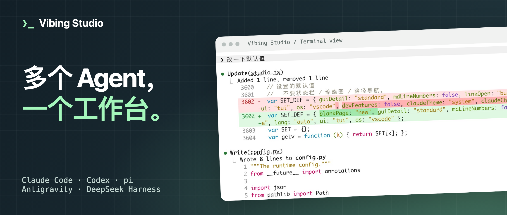
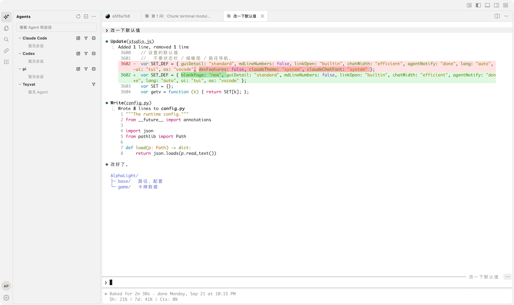
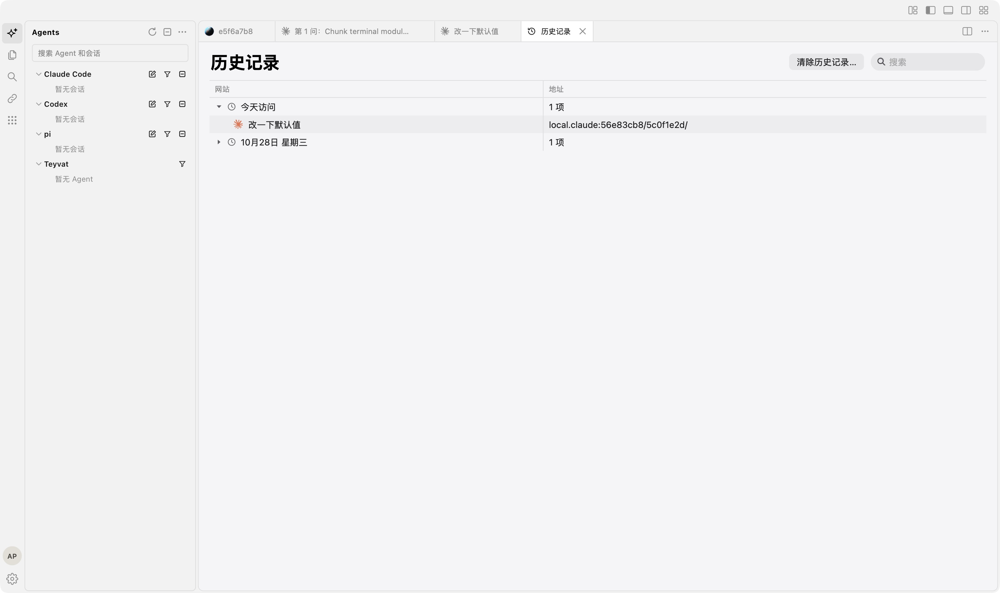
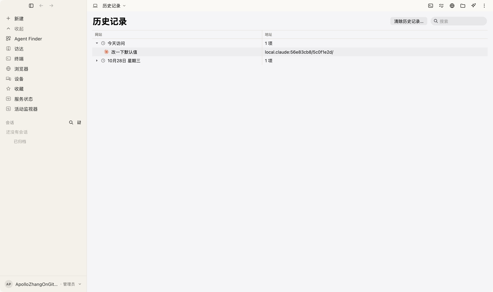

<h1 align="center">Vibing Studio</h1>

<p align="center"><strong>在桌面上用 TUI 跟进编程 Agent：读命令、看 diff、接着上一轮说。</strong></p>

<p align="center">
  <a href="https://github.com/ApolloZhangOnGithub/vibing-studio/releases/latest"><strong>下载桌面版 ↗</strong></a>
  &nbsp; · &nbsp; <a href="#开始使用">开始使用</a>
  &nbsp; · &nbsp; <a href="#终端视图里的细节">界面预览</a>
  &nbsp; · &nbsp; <a href="https://github.com/ApolloZhangOnGithub/vibing-studio/issues">反馈问题</a>
</p>



昨天在 Codex 里追的 bug，今天在 Claude Code 里改的代码，都能从左侧会话列表找到。打开原来的对话，查看它刚跑的命令，点开回复里提到的文件；需要同时盯两个任务时，就把标签拖到旁边分屏。

## 开始使用

1. **下载适合你电脑的安装包。** [打开最新版本](https://github.com/ApolloZhangOnGithub/vibing-studio/releases/latest)，在 **Assets** 中按下表选择。
2. **连接你平时用的工具。** 打开 Vibing Studio，进入「设置 → 连接器」。先启用一个已经在本机安装并登录的工具，例如 Codex 或 Claude Code。
3. **打开第一条会话。** 展开左侧对应的连接器和工作目录，选择一条已有对话。如果列表为空，先在原工具里完成一轮对话，再回来刷新列表。

| 你的电脑 | 选择的文件 |
| --- | --- |
| Mac，Apple 芯片（M 系列） | `macOS-AppleSilicon.zip`，解压后将 App 拖入「应用程序」 |
| Mac，Intel 处理器 | `macOS-Intel.zip`，安装方式相同 |
| Linux，Intel / AMD 64 位 | Debian / Ubuntu 选 `amd64.deb`，也可选 `x86_64.AppImage` |
| Linux，ARM 64 位 | 选 `arm64.deb` 或 `arm64.AppImage` |

macOS 版要求 macOS 14 或更高版本。在苹果菜单的「关于本机」中可以看到芯片和系统版本。

## 为什么把这些会话放进同一个工作台？

**从终端开始的工作，可以在桌面接着做。** 假设你昨天在终端里让 Codex 排查一个失败的构建。今天打开 Studio，在对应工作目录下点进那条线程，就能沿着原来的提问、命令和输出往下读。连接器读取各工具自己的会话存档，保留原会话 ID。对 Codex，发送时还会查询线程是否已载入、有无正在运行的回合，再选择继续当前回复、排队或恢复会话。这个区别决定了补充一句“只查解析器”会送到哪里。

**一条命令就是一个可展开的现场。** 连接器把工具请求和返回结果配对，TUI 把命令、退出状态、输出预览放在一起。比如 Codex 连续搜索、读文件时，先看到一组 `Explored`；运行脚本失败时，直接看到退出码和几行输出。点开这一组就能查细节，收起后继续读下一步。改文件时，增删行在 diff 中区分着色，方便顺着 Agent 的操作核对改动。

**多个任务并排时，你可以决定哪些信息值得占一行。** 例如，左侧分屏盯着 Codex 跑命令，右侧分屏阅读另一个 Agent 的结论。点分屏工具栏的三横线，可在完整过程、正文和最终回复之间切换。运行中的标签显示黄点，后台收到新回复显示蓝点。这样既能留意另一项工作何时结束，也能把当前窗口留给正在读的内容。

**从回复里的文件名直接回到项目。** Agent 写下的相对路径，需要结合它当时的工作目录才能定位。Studio 用会话目录解析文件引用，将可打开的文件放进新标签；文件上方的面包屑保留目录层级。两个项目都有同名脚本时，可以先核对路径，再对照原回复读代码。

## 终端视图里的细节



**看进度时留一行，看问题时展开。** 等一个长任务时，底栏显示回合状态；在支持的 Codex 会话里，上下文压缩和等待后台终端有各自的提示。回看完成的任务时，可以沿着工具摘要找到具体命令。分屏变窄后，正文和命令输出按当前窗格宽度排版。

<details>
<summary>查看文件浏览器与新会话界面</summary>

| 文件与 Agent 浏览器 | 新会话 |
| --- | --- |
|  |  |

</details>

## 连接器

| 工具 | 可以从哪里开始 |
| --- | --- |
| Claude Code | 打开项目历史，继续对话，也可以查看后台会话。 |
| Codex | 打开已有线程，跟进命令执行，查看回复和代码改动。 |
| Google Antigravity（agy） | 按工作目录浏览本机会话。向已经打开的终端会话输入时，macOS 连接器使用 iTerm2。 |
| DeepSeek Harness（DSH） | 浏览 DSH 工作区和会话存档。要继续发送消息，请先在连接器设置中连接 DSH。 |
| pi | 启用扩展连接器后，打开本机 pi 会话。 |

## 数据与服务

Claude Code、Codex 的本机会话浏览、文件和终端可独立于 Studio 的在线服务使用。发送消息时，模型访问由相应工具的账户和配置决定。Studio 的登录、设置同步和翻译会使用在线服务。

## 从源码运行

在安装了 Xcode 命令行工具的 Mac 上，进入仓库根目录运行：

```sh
tools/build-app.sh
open "Vibing Studio.app"
```

默认生成的 App 位于仓库根目录。[原生 App 构建说明](app/README.md) · [MIT 许可证](LICENSE)
