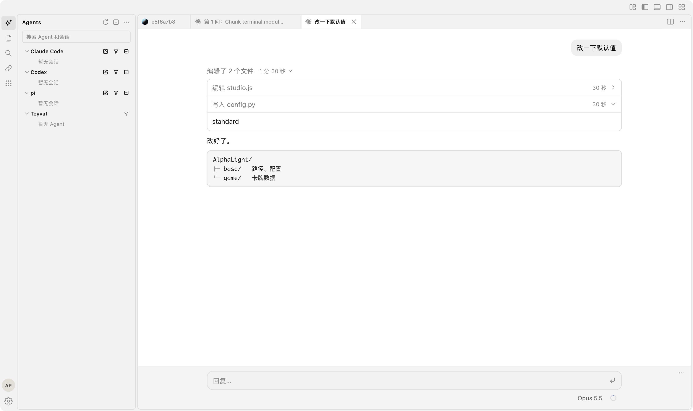

<h1 align="center">Vibing Studio</h1>

<p align="center"><strong>把散落在各个终端里的 AI 编程会话，按项目放回同一个工作台。</strong></p>

<p align="center">
  <a href="https://github.com/ApolloZhangOnGithub/vibing-studio/releases/latest"><strong>下载桌面版 ↗</strong></a>
  &nbsp; · &nbsp; <a href="#开始使用">开始使用</a>
  &nbsp; · &nbsp; <a href="#选择你的视图">界面预览</a>
  &nbsp; · &nbsp; <a href="https://github.com/ApolloZhangOnGithub/vibing-studio/issues">反馈问题</a>
</p>


昨天在 Codex 里追的 bug，今天在 Claude Code 里改的代码，都能从左侧会话列表找到。打开原来的对话，查看它刚跑的命令，点开回复里提到的文件；需要同时盯两个任务时，就把标签拖到旁边分屏。

## 开始使用

1. **下载适合你电脑的安装包。** [打开最新版本](https://github.com/ApolloZhangOnGithub/vibing-studio/releases/latest)，在 **Assets** 中按下表选择。
2. **连接你平时用的工具。** 打开 Vibing Studio，进入「设置 → 连接器」。先启用一个已经在本机安装并登录的工具，例如 Codex 或 Claude Code。
3. **打开第一条会话。** 展开左侧对应的连接器和工作目录，选择一条已有对话。如果列表为空，先在原工具里完成一轮对话，再回来刷新列表。

| 你的电脑 | 选择的文件 |
| --- | --- |
| Mac，Apple 芯片（M 系列） | `macOS-AppleSilicon.zip`，解压后将 App 拖入「应用程序」 |
| Mac，Intel 处理器 | `macOS-Intel.zip`，安装方式相同 |
| Linux，Intel / AMD 64 位 | Debian / Ubuntu 选 `amd64.deb`，也可选 `x86_64.AppImage` |
| Linux，ARM 64 位 | 选 `arm64.deb` 或 `arm64.AppImage` |

macOS 版要求 macOS 14 或更高版本。在苹果菜单的「关于本机」中可以看到芯片和系统版本。

## 在工作台里做什么

- **找回上次的上下文。** 按工具和工作目录浏览会话，用搜索定位项目或对话。Claude Code 和 Codex 直接读取本机已有的会话记录。
- **同时跟进几个任务。** 把不同会话并排打开。标签标题右侧的黄点表示运行中，蓝点表示有新回复，读完后回到绿色。
- **决定看多少过程。** 点击分屏工具栏的三横线，在完整过程、正文和最终回复之间循环切换。需要排查某一步时，展开对应的工具调用即可查看输出。
- **从回复走到文件。** 点击会话里可打开的文件引用，在新标签中阅读源码。文件上方的面包屑显示它在项目中的位置。

## 选择你的视图

首页大图是 **终端视图（TUI）**，命令、输出和 diff 按执行顺序排列。切换到 **图形视图（GUI）** 后，同一段会话以对话和工具卡片呈现，更方便回读长回复。



<details>
<summary>查看文件浏览器与新会话界面</summary>

| 文件与 Agent 浏览器 | 新会话 |
| --- | --- |
|  |  |

</details>

## 连接器

| 工具 | 可以从哪里开始 |
| --- | --- |
| Claude Code | 打开项目历史，继续对话，也可以查看后台会话。 |
| Codex | 打开已有线程，跟进命令执行，查看回复和代码改动。 |
| Google Antigravity（agy） | 按工作目录浏览本机会话。向已经打开的终端会话输入时，macOS 连接器使用 iTerm2。 |
| DeepSeek Harness（DSH） | 浏览 DSH 工作区和会话存档。要继续发送消息，请先在连接器设置中连接 DSH。 |
| pi | 启用扩展连接器后，打开本机 pi 会话。 |

## 数据与服务

Claude Code、Codex 的本机会话浏览、文件和终端可独立于 Studio 的在线服务使用。发送消息时，模型访问由相应工具的账户和配置决定。Studio 的登录、设置同步和翻译会使用在线服务。

## 从源码运行

在安装了 Xcode 命令行工具的 Mac 上，进入仓库根目录运行：

```sh
tools/build-app.sh
open "Vibing Studio.app"
```

默认生成的 App 位于仓库根目录。[原生 App 构建说明](app/README.md) · [MIT 许可证](LICENSE)
